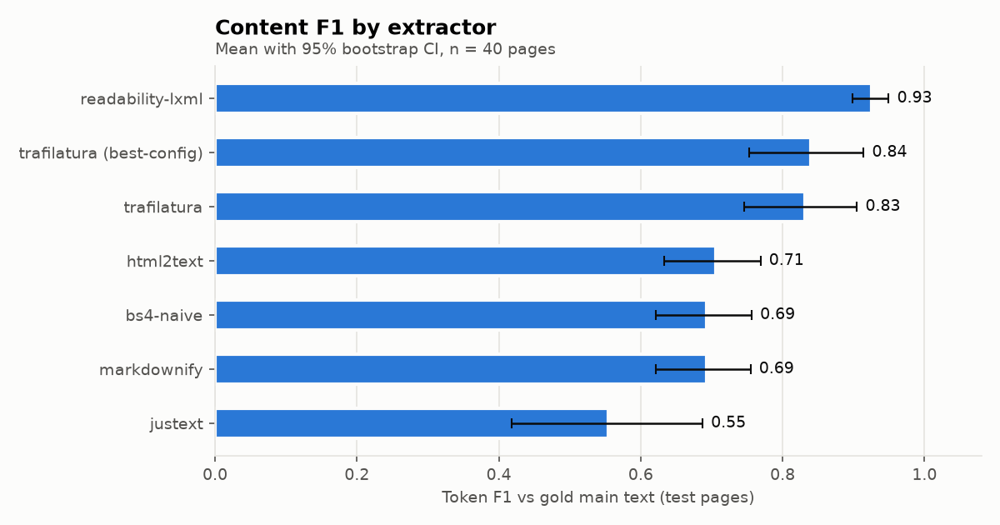
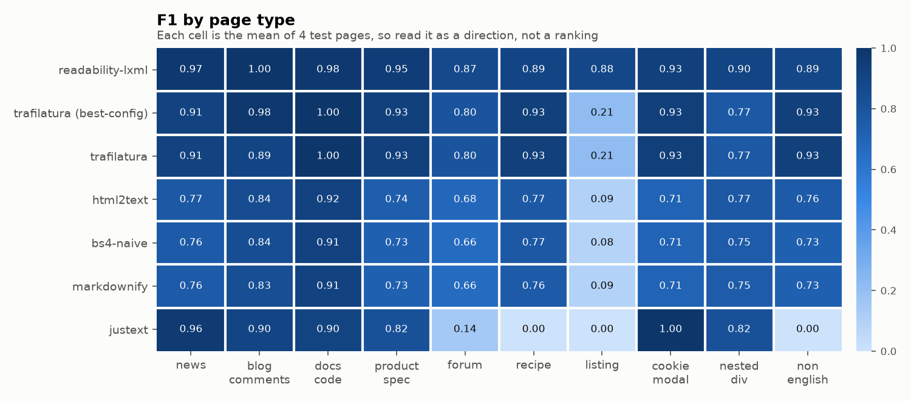
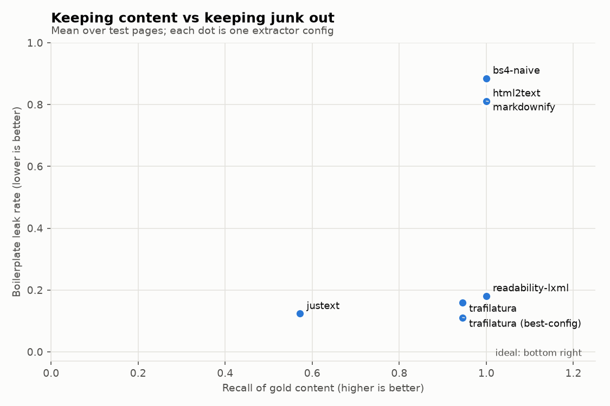
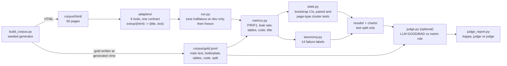

# extract-bench

A small, reproducible benchmark of open-source HTML-to-text extractors. It runs six tools on 60 seeded synthetic pages, scores them against gold text that is known by construction, puts 95% bootstrap confidence intervals on every headline number, and labels each failure with a rule-based taxonomy.

Everything runs locally. No API keys, no network at run time, no paid services. The one exception is the optional Wikipedia real-page slice, which fetches its pages once (see below); the tests and the main benchmark never touch the network.



> **Read this first.** The ranking in the table below is from synthetic pages I wrote, and it does not hold on real pages. On 40 real Wikipedia articles (gold from the Wikipedia API, not from me) jusText is first at 0.849 [0.812, 0.882], readability-lxml second at 0.788 [0.744, 0.829], trafilatura third at 0.735 [0.694, 0.775]. Spearman rank correlation with the synthetic order is 0.20. It is one site template, so it is a warning about the synthetic ranking, not a new ranking. See [Real-page check (Wikipedia)](#real-page-check-wikipedia).

## Why this exists

Every AI agent that reads the web does the same first step: fetch HTML, turn it into text. If that step keeps the cookie banner and drops the recipe, nothing after it can fix the answer. Teams that pick a web tool for their agent usually look at a vendor's own numbers or a single average.

This project is an outside-in benchmark of other people's tools, done the way I think benchmark work should be done:

- a corpus with known gold, a dev/test split, and results reported on test only
- confidence intervals, and a paired test that says "not significantly different" when the interval crosses zero
- a failure taxonomy that shows *how* each tool breaks, not just a score
- a written "limits of this benchmark" section, because a benchmark that hides its limits is marketing

The write-up for a general audience is in [POST.md](POST.md).

## Headline results (40 test pages)

| Extractor | F1 [95% CI] | Leak rate | Median ms |
|---|---|---|---|
| readability-lxml | 0.925 [0.898, 0.949] | 0.181 | 4 |
| trafilatura (best-config) | 0.840 [0.753, 0.914] | 0.111 | 10 |
| trafilatura | 0.831 [0.746, 0.905] | 0.160 | 11 |
| html2text | 0.706 [0.634, 0.769] | 0.811 | 1 |
| bs4-naive | 0.693 [0.621, 0.756] | 0.885 | 1 |
| markdownify | 0.693 [0.622, 0.755] | 0.811 | 4 |
| justext | 0.554 [0.418, 0.687] | 0.124 | 3 |

- Top two, paired bootstrap over pages: readability-lxml minus tuned trafilatura = +0.085 [+0.018, +0.166], significantly different.
- But pages of one type share a template, so they are not independent. Resampling whole page types gives [-0.005, +0.227]: **not significantly different**.
- Sensitivity check without the 4 listing pages (where the gold is a judgment call): +0.020 [-0.018, +0.072], **not significantly different** either way of resampling. Most of the gap comes from one page type.
- jusText returned an empty string with no error on 15 of 40 test pages (all non-English pages, all recipes, all listings, 3 forum threads).
- html2text and markdownify keep everything: recall 1.00, but nav menus leak on 40 of 40 pages and output is about 1.7 times the real content.
- trafilatura keeps reader comments by default. Dev tuning picked `include_comments=False`, which removed comment leaks on 4 test pages.

Full generated tables: [results/RESULTS.md](results/RESULTS.md). Latency numbers come from one Windows laptop and are only good for ordering.





## How it fits together



## Try it on one page

`python -m extract_bench.demo blog_comments-2` runs every tool on one test page and prints the scores, the first lines of each output, and which planted boilerplate leaked. Recorded output (trimmed by `--lines 3`):

```text
page: blog_comments-2  type: blog_comments  lang: en  split: test
gold title: Switching to a standing desk changed my mornings
gold main text: 534 tokens, 8 boilerplate snippets planted

extractor             F1     P     R  leak  labels
trafilatura         0.94  0.89  1.00  0.50  comment_or_signature_leak
readability-lxml    1.00  1.00  1.00  0.00  title_wrong
justext             0.94  0.88  1.00  0.50  comment_or_signature_leak
html2text           0.91  0.84  1.00  0.88  nav_or_footer_leak, comment_or_signature_leak
bs4-naive           0.91  0.83  1.00  0.88  nav_or_footer_leak, comment_or_signature_leak, title_wrong
markdownify         0.90  0.82  1.00  0.88  nav_or_footer_leak, comment_or_signature_leak

--- trafilatura  (607 words, title: 'Switching to a standing desk changed my mornings')
    Switching to a standing desk changed my mornings
    Growing tomatoes on a balcony convinced me that cheap tools are often good enough even on the...
    Training for a half marathon showed me quickly that the hardest part is starting and I wish I...
    ... (11 more lines)
    leaked: comment x4

--- readability-lxml  (542 words, title: 'Switching to a standing desk changed my mornings | The Morning Ledger')
    Switching to a standing desk changed my mornings
    Growing tomatoes on a balcony convinced me that cheap tools are often good enough even on the...
    Training for a half marathon showed me quickly that the hardest part is starting and I wish I...
    ... (6 more lines)

--- justext  (611 words, title: None)
    Switching to a standing desk changed my mornings
    Growing tomatoes on a balcony convinced me that cheap tools are often good enough even on the...
    Training for a half marathon showed me quickly that the hardest part is starting and I wish I...
    ... (15 more lines)
    leaked: comment x4

--- html2text  (655 words, title: None)
    * [Home](/home)
    * [Archive](/archive)
    * [About](/about)
    ... (26 more lines)
    leaked: comment x4, footer x1, footer_links x1, nav x1

--- bs4-naive  (650 words, title: 'Switching to a standing desk changed my mornings | The Morning Ledger')
    Switching to a standing desk changed my mornings | The Morning Ledger
    Home
    Archive
    ... (29 more lines)
    leaked: comment x4, footer x1, footer_links x1, nav x1

--- markdownify  (667 words, title: None)
    Switching to a standing desk changed my mornings | The Morning Ledger
    * [Home](/home)
    * [Archive](/archive)
    ... (29 more lines)
    leaked: comment x4, footer x1, footer_links x1, nav x1
```

What this one page shows: F1 alone would call trafilatura and jusText fine (0.94), but both kept all four reader comments. That is why leak rate is reported next to F1. `--html your_page.html` runs the same tools on any file, without scores.

## How to run

Python 3.11 or newer.

```bash
python -m venv .venv
. .venv/bin/activate            # Windows: .venv\Scripts\activate
pip install -r requirements.txt

python -m extract_bench.build_corpus     # rebuild the 60 fixtures + gold (deterministic)
python -m extract_bench.run              # full run: results/ and charts/ (about 30 seconds)
python -m extract_bench.run --quick      # fewer resamples, 1 timing repeat
python -m extract_bench.side_checks      # jusText stoplists + readability short_title() (not ranked)
python -m extract_bench.demo blog_comments-2   # one page, every tool, side by side
python -m extract_bench.wikislice build  # optional, needs network: redraw 40 Wikipedia pages, cache HTML + gold under .cache/
python -m extract_bench.wikislice run    # score the Wikipedia slice, adds a section to results/RESULTS.md
python -m pytest -q                      # full suite (one test runs the whole benchmark in --quick mode)
```

GitHub Actions (`.github/workflows/tests.yml`) runs on every push with Python 3.11 and 3.12: it rebuilds the corpus and fails if any fixture changes, runs the test suite, and runs the demo.

Optional LLM judge (off by default, never part of the ranking):

```bash
python -m extract_bench.judge --mock     # offline stand-in, only checks the pipeline
GROQ_API_KEY=... JUDGE_MODEL=openai/gpt-oss-120b python -m extract_bench.judge --per-extractor 20 --out-name judge_gpt-oss-120b.json
python -m extract_bench.judge_report results/judge_gpt-oss-120b.json results/judge_qwen3.8-27b.json   # writes results/JUDGE.md
```

Without a key the judge writes a file with `skipped: true` and stops.

## Does the metric agree with an LLM judge?

The token metric is my choice, so I checked it against two LLM judges. Each judge sees the gold main text and one tool's output and answers GOOD or BAD. The metric rule says GOOD when F1 is at least 0.8 and leak rate is at most 0.2. Sample: 20 test pages per extractor, 140 items, seed 7, the same items for both judges, Groq free tier, temperature 0, 0 failed calls.

| Judge | Agreement with metric rule | Cohen's kappa [95% CI] | Share judged GOOD |
|---|---|---|---|
| qwen/qwen3.8-27b | 0.89 | 0.74 [0.61, 0.86] | 0.27 |
| openai/gpt-oss-120b | 0.82 | 0.52 [0.36, 0.67] | 0.14 |
| the two judges with each other | 0.84 | 0.53 [0.37, 0.69] | |

The metric rule says GOOD on 0.32 of the items. Full tables: [results/JUDGE.md](results/JUDGE.md).

What I take from it:

- **Where they disagree, the metric is the lenient one.** The two judges agree with each other on 118 of 140 items. On 9 of those 118 the metric disagrees with both, and on all 9 the metric said GOOD and both judges said BAD. In 3 of the 9 the tool dropped 21 to 26% of the real text (recall 0.74 to 0.79) but had precision near 1.0, so F1 still cleared 0.8. In the other 6, recall was at least 0.86 but precision was 0.71 to 0.95: extra text got through, either text the leak rule does not track or tracked boilerplate that stayed under its 0.2 limit.
- **No disagreement on the clear cases.** bs4, html2text and markdownify are BAD on all 60 of their items for the metric and for both judges.
- **The choice of judge matters about as much as the metric.** gpt-oss-120b is much stricter than qwen3.8-27b, and the two judges agree with each other (kappa 0.53) less well than qwen agrees with the metric (0.74). One judge model is not ground truth.
- **The judge is not fully stable.** I re-asked gpt-oss-120b 12 of its BAD-versus-metric-GOOD items with the same prompt at temperature 0. Every reply ended normally (no cut-off output read as BAD), but 2 of 12 came back GOOD this time ([results/judge_recheck_gpt-oss-120b.txt](results/judge_recheck_gpt-oss-120b.txt)).
- **Post-hoc only:** a stricter rule (precision and recall both at least 0.9, leak at most 0.2) raises kappa to 0.89 with qwen and 0.59 with gpt-oss. I picked it after seeing these same items, so it is a lead for the next version, not a result.

## Real-page check (Wikipedia)

The 60 pages above are synthetic and I wrote their gold, so I added a small slice where I wrote neither. It is a separate check, never pooled with the 40 test pages.

- **Pages:** 40 English Wikipedia articles from a seeded random draw over page ids (seed 20261023; main namespace, no redirects or disambiguation pages, 20 to 150 KB of wikitext, at least 800 gold tokens). The rule was fixed before any tool ran. The input is the normal rendered article page, so nav, sidebar, footer, reference list and navboxes are all there.
- **Gold:** the MediaWiki plain-text extract (`prop=extracts&explaintext=1`) of the same revision, normalised: headings kept as text, See also / Notes / References / Further reading / External links / Bibliography / Sources sections removed, whitespace collapsed.
- **Same code:** the repo's own `metrics.score`, `run.evaluate` and bootstrap. No leak rate here, because this gold has no boilerplate labels.

| Extractor | F1 [95% CI] | Precision | Recall |
|---|---|---|---|
| jusText | 0.849 [0.812, 0.882] | 0.936 | 0.802 |
| readability-lxml | 0.788 [0.744, 0.829] | 0.763 | 0.888 |
| trafilatura (default and best-config, identical here) | 0.735 [0.694, 0.775] | 0.598 | 1.000 |
| bs4-naive | 0.626 [0.584, 0.669] | 0.471 | 1.000 |
| html2text | 0.606 [0.562, 0.651] | 0.450 | 1.000 |
| markdownify | 0.588 [0.545, 0.631] | 0.430 | 1.000 |

**The synthetic ranking does not carry over.** jusText was last on the synthetic test set (0.554, mostly from empty output on non-English, recipe, listing and forum pages) and is first here, where every page is an English article. readability-lxml, first on the synthetic set, is second: jusText minus readability-lxml is +0.061 [+0.019, +0.103] over pages. The synthetic top pair also separates here: readability-lxml minus tuned trafilatura is +0.052 [+0.008, +0.098]. What does hold: the three converters and the naive baseline are at the bottom, and readability-lxml and trafilatura beat them. Spearman rank correlation with the synthetic order is 0.20 (7 rows) and 0.09 (6 default-config tools). Details, a sensitivity check and caveats are in [results/RESULTS.md](results/RESULTS.md).

Caveats that matter when reading this:

- **One site template.** The 40 pages are 40 articles, not 40 layouts. The intervals cover article-to-article variation on one skin, and the page-type cluster test does not apply. This is a check on direction, not a second benchmark.
- **The gold drops infobox text, tables and captions**, and the reference lists are removed from it. Tools that keep those pay in precision. Keeping the See also / bibliography / external-links text in the gold (a sensitivity check chosen after the first run) moves F1 by at most 0.02 and does not change the order, so most of the precision cost is the footnote list and infobox text, which the API extract never has. Recall is the fairer column for tools that keep tables.
- **Licensing.** Wikipedia text is CC BY-SA 4.0. The fetched HTML and the gold text are not in this repo: `corpus/wikipedia/manifest.json` has the page ids, revision permalinks and SHA-256 hashes, and `python -m extract_bench.wikislice build` / `run` refetch and score them (1 request per second, descriptive User-Agent, cached under `.cache/`). Text: Wikipedia contributors, CC BY-SA 4.0. The scores and per-page numbers in `results/` are mine. Refetching later can show a different render of an old revision; the run prints a warning when a hash differs.

## The corpus

`extract_bench/build_corpus.py` generates 10 page types x 6 variants from a fixed seed:

| Page type | What makes it hard |
|---|---|
| news | related-articles block *inside* the article, share line, sidebar, noscript |
| blog_comments | reader comments right after the post (gold says comments are not content) |
| docs_code | `pre` code blocks with indentation, `<` and `**kwargs`, side nav, "on this page" TOC, options table |
| product_spec | spec table (some without `thead`), add-to-cart copy, "customers also bought" |
| forum | many short posts, signatures, reply buttons, forum rules box |
| recipe | short list items, ad slot, "jump to recipe" UI, reviews, nutrition table |
| listing | 12 to 24 product cards; gold is only the heading and intro line |
| cookie_modal | long consent text and a newsletter modal, sometimes first in the body, sometimes last |
| nested_div | no semantic tags, obfuscated class names, text split by `<br>`, one variant with no `h1` |
| non_english | Spanish, German, French, Portuguese, Italian, Hindi, with matching boilerplate |

Every page also has a script payload in `<head>`, a `<title>` that adds " | Site Name" to the visible headline, and half of them use div soup instead of `article`/`main`/`nav`.

Gold is recorded while the HTML is generated, so it is exact: main text units in reading order, boilerplate snippets tagged by kind, table rows, and code lines. The split is stratified: 2 dev and 4 test pages per type, 20 dev and 40 test in total. Tests check that every gold unit is really in its page, that no boilerplate snippet is inside the gold, that the split is disjoint, and that a rebuild gives byte-identical files.

## Metrics

All text is normalized first: markdown links and images become their visible text and URLs are dropped, so markdown output and plain text are scored the same way. Tokens are lowercased runs of letters and digits (Devanagari vowel signs stay attached).

- **Precision, recall, F1**: bag-of-tokens overlap with the gold main text. The gold title is removed once near the start of the output first, so putting the headline in the body text is neither rewarded nor punished.
- **Boilerplate leak rate**: share of boilerplate snippets that made it into the output. A snippet leaked when at least half of its 4-grams that are *not* also in the gold appear in the output.
- **Table rows kept**: share of rows whose tokens appear as one contiguous run.
- **Code lines kept / exact**: the same for code lines, plus an exact check that keeps leading indentation (a markdown 4-space shift is allowed).
- **Title match**: normalized predicted title equals the visible headline.
- **Latency**: median of 3 timed runs per page.

## Statistics

`extract_bench/stats.py`:

- Percentile bootstrap CI of the mean, resampling pages, 10,000 resamples, fixed seed. Same seed gives the same interval.
- Paired bootstrap on the per-page difference for two systems on the same pages. If the CI crosses 0 the verdict is "not significantly different".
- Cluster (page-type) paired bootstrap: the same test, but each resample draws whole page types. The 4 test pages of a type come from one template, so the page-level interval is too narrow when one type drives a gap. Both are reported for the top two; the per-row CIs in the tables are page-level.
- Cohen's kappa for the optional judge, with a percentile bootstrap CI over judged items.

## Fairness rules

- Every tool runs on library defaults. The config used for each row is printed in the results table.
- readability-lxml returns cleaned HTML, not text. Its adapter turns that HTML into text with a small helper (`adapters/_text.py`) that only adds line breaks at block tags and ` | ` between table cells; it removes nothing except `script`/`style` and HTML comments.
- Titles use each library's default call. For readability that is `title()`, which returns the whole `<title>` tag (0 of 40 matches). Its `short_title()` helper strips the site name and matches 35 of 40 (side check, `results/side_checks.json`).
- Exactly one extra "best-config" row: trafilatura, tuned on the 20 dev pages over a 6-setting grid (`results/tuning.json`), then frozen.
- Only test-split numbers are reported.
- Library versions are pinned in `requirements.txt` and printed in the header of `results/summary.json` and `results/RESULTS.md`.
- An exception inside a library is recorded as a failure for that page (score 0, label `crash`), not a crashed run. No crashes happened in the published run.

## Failure taxonomy

`extract_bench/taxonomy.py` assigns fixed-threshold labels to each (tool, page): `crash`, `empty_output`, `low_recall`, `over_extraction`, six leak labels (nav or footer, consent or modal, related or teaser, comment or signature, script or noscript, commerce or listing), `table_lost`, `code_lost`, `code_flattened`, `title_wrong`. Counts per tool are in `results/taxonomy.json`; concrete examples with output excerpts are in `results/excerpts.json`.

## Limits

- **Synthetic pages.** Template text and my guesses at common layouts. The Wikipedia slice above is the first real-page check and it reorders the tools (jusText first, not last), so the synthetic ranking should not be read as a ranking of real pages. The slice is one site template, 40 articles.
- **Same author for pages and gold** on the 60 synthetic pages. I decided what counts as content, and the listing-page sensitivity check shows how much one decision can move the ranking. The Wikipedia slice does not have this problem, but its gold (the API extract) leaves out infobox text and tables.
- **No JavaScript rendering.** Static HTML only.
- **Small n, few templates.** 40 test pages, 4 per type, from 10 templates. Per-type cells are directions, not rankings, and the honest unit of variation is closer to 10 page types than 40 pages.
- **Metric is not a human, and neither is the judge.** The judges were run on a 20-per-tool sample (140 items), not all 420 outputs. Bag-of-words F1 ignores order and formatting. Two LLM judges were run on 140 items (above), but no human labels exist, and the two judges disagree with each other about as often as with the metric.
- **Uneven tuning.** Only trafilatura got a tuned row. The side check shows jusText recovers on German and French with the right stoplist, but not on Italian or Hindi.
- **No third-party content in git.** The 60 synthetic pages are generated by `build_corpus.py` from sentence banks written for this project, with invented company names. The Wikipedia slice is CC BY-SA, so its HTML and gold text are kept out of the repo (manifest, hashes and a fetch script only).
- **One machine** for latency. Latency also moves a little on every rerun; every other number is identical run to run.

## What I would do next

1. Hand-label about 40 of the 140 judged items (GOOD or BAD, blind to both the metric and the judges). Then measure each judge's true-positive and true-negative rate against a human, with bootstrap intervals. Today the judges are only compared with the metric and with each other.
2. Done in part: the Wikipedia slice has gold I did not write, and the ranking did not hold. Still missing: real pages from several different site templates (news, docs, forums, shops), with gold labelled by someone other than me.
3. Write the listing-page rule down before scoring and report a second gold variant, so the one judgment call that moves the ranking is visible in the main table.
4. Pre-register the stricter metric rule (precision and recall both at least 0.9) and test it on fresh pages instead of the ones it was picked on.
5. Tune jusText (right stoplist per language) and the other tools with the same dev-only grid, so tuning is even.

## Licence

MIT, see [LICENSE](LICENSE). It covers the code and the generated corpus. It does not cover Wikipedia text, which is CC BY-SA 4.0 and is not stored here.

## Layout

```
extract_bench/
  build_corpus.py   seeded generator, gold, split
  textbanks.py      sentence banks (main text and boilerplate kept apart)
  adapters/         one module per tool, common extract(html) -> {title, text}
  metrics.py        per-page scoring
  stats.py          bootstrap, paired bootstrap, kappa
  taxonomy.py       failure labels
  run.py            end-to-end run, writes results/
  charts.py         matplotlib charts
  judge.py          optional LLM judge
  side_checks.py    off-protocol checks, not ranked
  judge_report.py   judge vs metric vs judge, writes results/JUDGE.md
  demo.py           one page, every tool, side by side
  wikislice.py      Wikipedia real-page slice: seeded page draw, fetch + cache, normaliser, scoring
corpus/             60 HTML fixtures + gold.jsonl; corpus/wikipedia/manifest.json (ids, revisions, hashes only)
results/            summary.json, paired.json, taxonomy.json, excerpts.json, per_doc.csv, outputs.jsonl, RESULTS.md,
                    judge_*.json + JUDGE.md (LLM judge runs)
charts/             f1_ci.png, f1_by_page_type.png, leak_vs_recall.png, latency.png
tests/              pytest suite
POST.md             plain-words write-up
.github/workflows/  CI: rebuild corpus and check it matches, run tests, run the demo
```

Adding a tool means adding one adapter module and one line in `extract_bench/adapters/__init__.py`.
